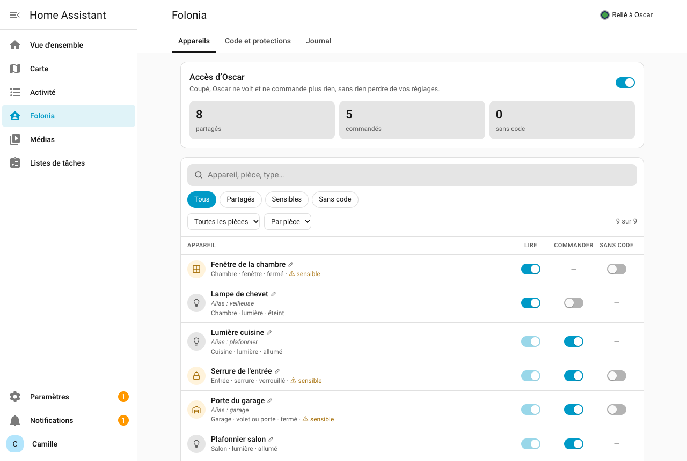
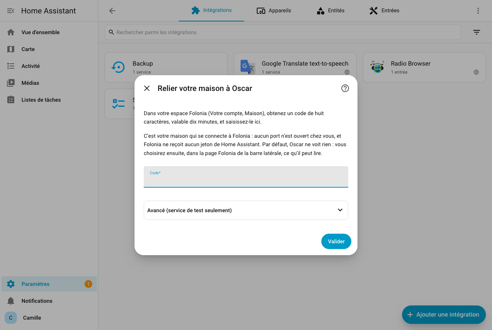
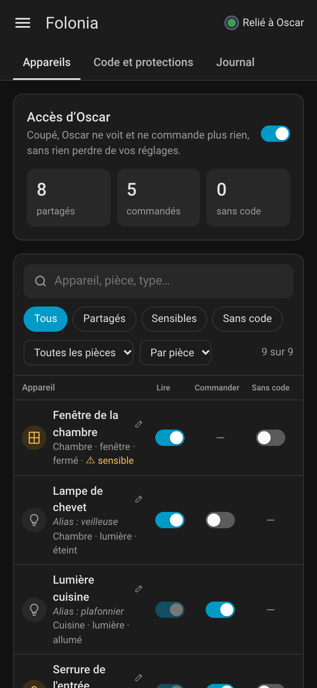
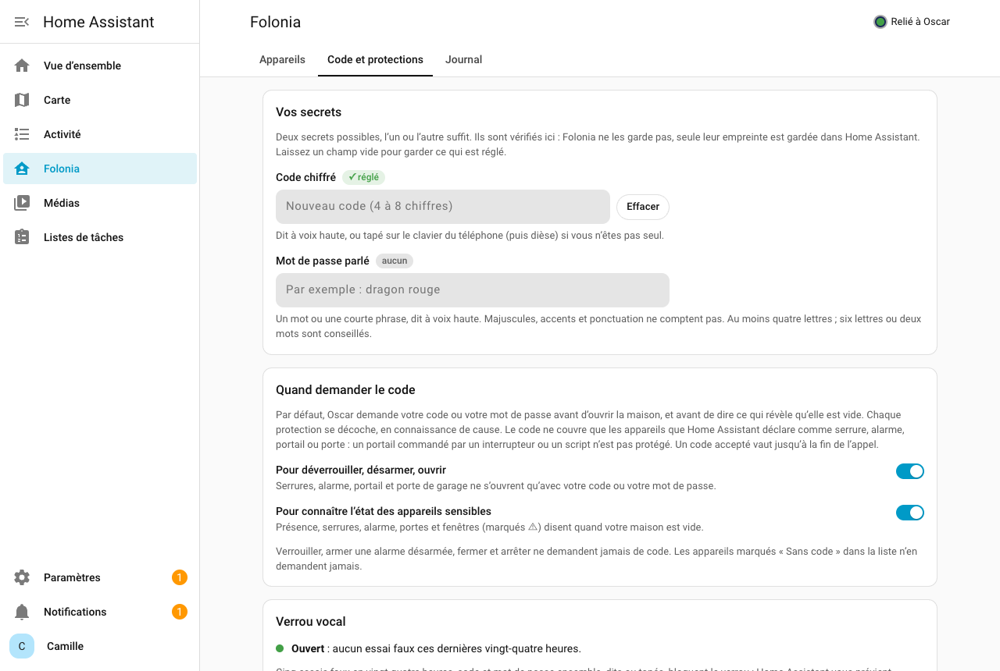

# Folonia pour Home Assistant

**Votre maison répond au téléphone.** « J’ai bien fermé le garage ? », « Il fait combien dans le
salon ? », « Éteins la cuisine. » Oscar, l’assistant qu’on appelle de
[Folonia](https://folonia.fr), lit et commande les seuls appareils que **vous** choisissez, mains
libres et sans application. Aucun port ouvert chez vous, aucun jeton de Home Assistant qui sort.

- **Essai gratuit** : [30 minutes à utiliser sous 14 jours](https://compte.folonia.fr/essai-long?utm_source=marketplace),
  sans carte, maison comprise (mobiles français, une fois par numéro).
- **Ensuite** : un [abonnement Folonia](https://folonia.fr/#tarifs), à partir de 9,99 € par mois,
  sans engagement. L’intégration elle-même est gratuite et sous licence Apache 2.0.
- **Pour qui** : Folonia est proposé aux personnes qui résident en France. *Folonia is sold in
  France only; [summary in English](#in-english) below.*

<!-- ha-marketplace:exclude-start -->
[](https://my.home-assistant.io/redirect/marketplace_repository/?owner=folonia&repository=folonia-home-assistant&category=integration)
[](https://my.home-assistant.io/redirect/config_flow_start/?domain=folonia)
<!-- ha-marketplace:exclude-end -->



## Ce qu’Oscar peut faire

- **Lire** l’état des appareils que vous partagez : portes, fenêtres, volets, lumières,
  températures, chauffage, alarme, présence.
- **Commander** ceux que vous cochez en commande : allumer, éteindre, ouvrir, fermer, arrêter,
  verrouiller, armer, régler une température, une position ou une luminosité, lancer une scène.
- Rien d’autre : il ne voit ni ne commande ce que vous n’avez pas coché.

## Vos garanties

- **Votre maison n’expose rien.** Home Assistant ouvre une connexion sortante vers Folonia :
  aucun port ouvert, aucune redirection de routeur.
- **Aucun jeton de Home Assistant ne sort.** La liaison est appariée une fois par un code de
  huit caractères, et ne permet que les questions et commandes prévues.
- **Par défaut, Oscar ne voit rien.** Vous choisissez un appareil à la fois, parmi ceux déjà
  exposés aux assistants vocaux. La règle est appliquée chez vous, à chaque demande.
- **Tout est au journal de bord.** Chaque lecture, chaque commande, chaque code refusé, jamais
  le code ni le mot de passe lui-même.
- **Un interrupteur coupe tout.** « Accès d’Oscar » éteint : la liaison est fermée, rien ne
  sort ; Oscar dit que l’accès est coupé.
- **Par défaut, rien n’est conservé chez Folonia.** Ce qu’Oscar lit sert à répondre pendant
  l’appel, puis est oublié. Seule exception, à votre demande : voir [Données](#données).

## Installer

Il faut Home Assistant 2026.2 ou plus récent et un compte Folonia (essai ou abonnement).

**Depuis Home Assistant 2026.11, avec la Marketplace :**

1. **Paramètres**, **Marketplace**, cherchez **Folonia**, puis **Installer**. Tant que Folonia
   n’est pas au catalogue, touchez le bouton **Ouvrir dans la Marketplace** ci-dessus, ou ajoutez
   l’adresse `https://github.com/folonia/folonia-home-assistant` depuis **Ajouter grâce à un lien
   GitHub** : Home Assistant demande alors une connexion GitHub, qui ne lit que des données
   publiques.
2. L’installation mène directement au formulaire d’ajout : aucun redémarrage la première fois.

La Marketplace rappelle, à juste titre, que les extensions de la communauté ne sont ni testées ni
auditées par le projet Home Assistant : lisez [Vos garanties](#vos-garanties) et
[Données](#données) pour savoir ce que celle-ci fait.

**Avant Home Assistant 2026.11, avec [HACS](https://hacs.xyz) :** menu (les trois points),
**Dépôts personnalisés**, même adresse, catégorie **Intégration**. Installez **Folonia**, puis
redémarrez Home Assistant.

## Relier votre maison

1. Sur [folonia.fr](https://folonia.fr), **Votre compte**, section **Maison** : **Obtenir un
   code** (dix minutes, une seule fois). Pas encore de compte ?
   [Prenez l’essai de 30 minutes](https://compte.folonia.fr/essai-long?utm_source=marketplace).
2. Dans Home Assistant : **Paramètres**, **Appareils et services**, **Ajouter une
   intégration**, **Folonia**, puis saisissez le code.
3. L’appareil **Folonia** apparaît, avec l’interrupteur **Accès d’Oscar** et le capteur
   **Liaison**.



## Choisir ce qu’Oscar lit et commande

1. Exposez les appareils voulus aux assistants vocaux : **Paramètres**, **Assistants vocaux**,
   onglet **Exposer**.
2. Dans la page **Folonia** de la barre latérale, onglet **Appareils** : cochez ce qu’Oscar
   peut lire, puis ce qu’il peut commander, et **Enregistrer** ; onglet **Code et protections** :
   choisissez un code, un mot de passe, ou les deux.

Pourquoi deux étapes ? Home Assistant expose d’office certains appareils nouveaux ; sans le
choix propre à Folonia, Oscar en verrait plus que vous ne l’avez décidé. Retirer l’exposition
retire aussi l’appareil à Oscar.

## La page Folonia

Tout se règle dans la page **Folonia** de la barre latérale de Home Assistant, réservée aux
administrateurs. Pour l’ouvrir : **Folonia** dans la barre latérale, ou **Paramètres**,
**Appareils et services**, **Folonia**, **Configurer**, ou l’adresse `/folonia` de votre Home
Assistant. Elle suit le thème clair ou sombre de Home Assistant et se lit sur téléphone.



- **Appareils** : l’interrupteur **Accès d’Oscar**, un résumé (appareils partagés, commandés,
  sans code), puis la liste des appareils exposés aux assistants vocaux, avec recherche (nom,
  pièce, alias, type), filtres (Tous, Partagés, Sensibles, Sans code), pièce et tri. Pour
  chacun : ses alias, sa pièce, son type et son état du moment, ⚠ s’il est sensible, et trois
  interrupteurs, **Lire**, **Commander** (qui coche Lire) et **Sans code** (pour un appareil
  partagé qui est sensible ou qui ouvre la maison).
- **Alias** : touchez le nom d’un appareil (✎) pour lui donner d’autres noms, par exemple
  « portillon » pour « Portail » : Oscar le reconnaît aussi sous ces noms. Ce sont les alias
  d’Assist : les modifier dans la page les modifie aussi pour Assist, et inversement. Ils
  s’enregistrent tout de suite, à part du reste. Les alias de la pièce s’affichent aussi ; ils se
  modifient dans les réglages des pièces de Home Assistant. Un appareil sans identifiant unique
  dans Home Assistant n’a pas d’alias.
- **Code et protections** : le code chiffré et le mot de passe parlé (réglé ou non ; un champ
  vide garde ce qui est réglé, **Effacer** l’efface), les deux protections, et l’état du verrou
  vocal (bloqué ou non, essais faux récents).
- **Journal** : ce qu’Oscar a lu et fait depuis le démarrage de Home Assistant, les plus récents
  d’abord, les refus en couleur. Tout est aussi au journal de bord de Home Assistant.

Rien n’est enregistré avant **Enregistrer** : la barre du bas compte les changements, **Annuler**
revient en arrière. Des choix qui demandent un secret alors qu’aucun n’est réglé sont
enregistrés quand même, et la page le dit : d’ici là, Oscar refuse ce qui demande un code.
Tout ce que la page envoie est vérifié par l’intégration, qui l’applique sans redémarrage.

Chaque protection est **cochée par défaut, expliquée, et se décoche** : nous proposons ce qu’il
faut pour la sécurité, mais si vous préférez faire autrement, c’est votre choix, sous votre
responsabilité.

| Réglage | Par défaut | Ce qu’il fait |
| --- | --- | --- |
| **Code pour déverrouiller, désarmer, ouvrir** | coché | Déverrouiller une serrure, désarmer l’alarme, ouvrir le portail ou la porte de garage demandent le code ou le mot de passe. Décoché, quiconque appelle depuis votre numéro peut le demander à Oscar. |
| **Code pour lire les appareils sensibles** | coché | La présence, une serrure, l’alarme, une porte ou une fenêtre (marquées d’un ⚠) disent quand votre maison est vide : Oscar n’en dit l’état qu’après le code ou le mot de passe. |
| **Appareils sans code** | aucun | Parmi les appareils partagés sous protection, ceux qu’Oscar lit et commande sans code, même cases cochées. Par exemple la porte du garage, pour demander « J’ai bien fermé le garage ? » sans code. |
| **Code chiffré**, **Mot de passe parlé** | aucun | Les secrets, l’un ou l’autre. Laissez le champ vide pour garder ce qui est réglé ; **Effacer** efface chacun. |

- Verrouiller, armer, fermer et arrêter ne demandent jamais de code.
- Un secret n’est exigé que si une protection cochée porte sur un appareil partagé et non
  exempté ; sinon, rien n’est imposé. Effacer le dernier secret alors qu’il protège encore un
  appareil partagé est refusé.
- Cinq essais faux en vingt-quatre heures, code et mot de passe ensemble, dits ou tapés, en
  lecture comme en commande, bloquent le verrou ; Home Assistant vous prévient. Éteignez puis
  rallumez « Accès d’Oscar », ou enregistrez un nouveau secret, pour débloquer.
- Une installation plus ancienne garde son code et ses choix ; les nouveaux réglages y prennent
  leur valeur par défaut. Depuis la version 0.5.0, **Configurer** mène à la page Folonia.

## Le code ou le mot de passe

Folonia, c’est d’abord le mains libres : le secret se dit à voix haute. Deux secrets possibles,
choisis dans la page Folonia (**Code et protections**) ; l’un ou l’autre suffit :

- un **code chiffré** de quatre à huit chiffres, dit à voix haute ou **tapé sur le clavier du
  téléphone** (puis dièse) si vous n’êtes pas seul ;
- un **mot de passe parlé** : un mot ou une courte phrase, par exemple « dragon rouge ».
  Majuscules, accents et ponctuation ne comptent pas. Quatre lettres au moins ; six lettres ou
  deux mots sont conseillés.

Ils sont vérifiés **chez vous** : seule leur empreinte est gardée dans Home Assistant, chacun se
règle et s’efface séparément. Folonia ne les garde pas : ce que vous dites ou tapez est transmis
avec la demande, puis oublié.



## Au téléphone

- « La porte du garage est fermée ? » (Oscar demande le code si la case est cochée et que la
  porte n’est pas exemptée.)
- « Il fait combien dans le salon ? »
- « Éteins la lumière de la cuisine. »
- « Ouvre le portail. » (Oscar demande le code ; vous le dites, ou vous dites « je le tape » et
  le tapez sur le clavier, puis dièse.)

Oscar ne répète jamais un code ni un mot de passe.

Si Home Assistant est éteint ou sans Internet, Oscar le dit tout de suite. Si un appareil lent ne
répond pas à temps, il vous dit qu’il ne sait pas si c’est fait : vérifiez. Le titulaire du compte
a accès à la maison, abonné ou pendant l’essai de 30 minutes. Les proches de votre abonnement et
l’appel de découverte de deux minutes, sans compte, n’y ont pas accès. À la fin de l’essai, Oscar
n’a plus accès à votre maison tant que vous n’êtes pas abonné ; la liaison est retirée 30 jours
après, sauf si vous vous êtes abonné entre-temps.

## Couper, délier

- **Couper, provisoirement** : éteignez **Accès d’Oscar**.
- **Délier depuis Folonia** : **Votre compte**, **Maison**, **Délier ma maison**.
- **Délier depuis Home Assistant** : supprimez l’intégration ; elle prévient Folonia.

## En cas de souci

- **« Code inconnu, expiré ou déjà utilisé »** : demandez un nouveau code dans votre espace.
- **« Folonia est injoignable »** : vérifiez l’accès à Internet de Home Assistant.
- **Rien à choisir** : aucun appareil n’est exposé aux assistants vocaux ; la page mène à
  l’écran d’exposition de Home Assistant.
- **Pas de page Folonia dans la barre latérale** : elle n’apparaît qu’aux administrateurs, et
  tant que l’intégration est chargée.
- **Liaison hors ligne** : elle se refait seule, avec un délai croissant (cinq minutes au plus).
- **Nouveau code demandé** : la maison a été déliée ; saisissez un nouveau code.
- **« Mettre à jour l’intégration Folonia »** : mettez-la à jour depuis la Marketplace (depuis HACS avant
  Home Assistant 2026.11).

**Télécharger les diagnostics** donne l’état de la liaison et les dernières lignes du journal,
sans secret ni code.

## Données

Sortent de chez vous, seulement pendant un appel et sans être gardés par Folonia : le nom, la
pièce, leurs alias, le domaine et la classe des appareils cochés ; l’état des seuls appareils demandés
(quelques attributs : luminosité, position, températures, humidité) ; la version de
l’intégration. Folonia ne garde que la liaison (une empreinte de son secret, sa date), effacée
quand vous déliez votre maison. L’état lu passe, pendant l’appel, par le fournisseur
d’intelligence artificielle d’Oscar ; voir la politique de confidentialité de Folonia. Un code
ou un mot de passe dit à voix haute passe lui aussi par ce fournisseur ; un code tapé sur le
clavier, non : il ne passe que par Folonia, sans être enregistré.

**Si vous cochez « Aider à améliorer Oscar »** dans votre espace Folonia (décoché par défaut), le
texte de vos appels est gardé 30 jours pour corriger les erreurs d’Oscar, y compris ce qu’il dit de
vos appareils. La phrase où vous donnez un code ou un mot de passe en est masquée. Décocher arrête
tout dès l’appel suivant, et ce qui a été gardé est effacé.

<!-- ha-marketplace:exclude-start -->
## Développement

Protocole de la liaison : `custom_components/folonia/protocol.py`. La page Folonia : un seul
module JavaScript, sans compilation ni dépendance, `custom_components/folonia/frontend/`, et ses
commandes WebSocket (`folonia/settings`, `folonia/save`, `folonia/secret`, `folonia/journal`,
`folonia/aliases`, réservées aux administrateurs) dans `websocket.py`. Tests contre le cœur de Home Assistant, avec
un faux service Folonia :

```sh
uv venv --python 3.14 .venv
uv pip install --python .venv/bin/python -r requirements_test.txt
.venv/bin/ruff check . && .venv/bin/ruff format --check . && .venv/bin/python -m pytest -q
```

Le banc de Home Assistant tourne sous Linux et macOS, pas sous Windows (WSL 2 ou la CI). La section repliée **Avancé** du formulaire d’ajout donne l’adresse du service, pour un
laboratoire.
<!-- ha-marketplace:exclude-end -->

## Licence

[Apache 2.0](https://github.com/folonia/folonia-home-assistant/blob/main/LICENSE), © 2026 DEVGO.
Pour signaler une faille : [politique de sécurité](https://github.com/folonia/folonia-home-assistant/blob/main/SECURITY.md).

Home Assistant est une marque de l’Open Home Foundation. Folonia est un service indépendant, sans
lien avec elle ni avec le projet Home Assistant.

---

## In English

Folonia is sold in France only. This integration links your Home
Assistant to your Folonia account (a 30-minute free trial, then a subscription), so that Oscar,
the phone assistant, can read and control the devices **you** pick, among those already exposed to voice
assistants. Your home opens an outbound connection: no open port, no Home Assistant token leaves
your home. By default, unlocking, disarming, opening a gate or garage door, and reading
presence, locks, alarm, doors and windows require a secret checked locally: a four to eight
digit code, spoken or typed on the phone keypad, or a spoken password (a word or a short
phrase), either one. Each protection can be unticked and devices can be exempted: your choice,
your responsibility. Five wrong attempts in twenty-four hours block the lock. Every read and
command goes to the logbook; the “Oscar access” switch cuts everything. Install from the Home
Assistant Marketplace (2026.11 or newer; HACS before that), then add the Folonia integration with
the eight-character code from your Folonia account. Settings live in the **Folonia** page of the
Home Assistant sidebar (administrators only; also reached through **Configure** on the
integration, or `/folonia`): shared devices with search and filters, code and protections, and
the integration’s log. Changes are kept until **Save** and checked by the integration. Oscar
also knows your devices and areas by their Assist aliases (“portillon” for “Portail”); a
device’s aliases can be edited from the page (tap its name) and are the same as Assist’s, while
area aliases are edited in the Home Assistant area settings. The page
is in French. Licensed under Apache 2.0.
